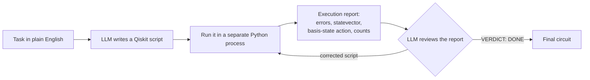

# Ketwright

**Plain-English quantum tasks in, checked Qiskit circuits out.**

Ketwright is an LLM agent that turns requests like *"prepare a 5-qubit GHZ state"*, *"Grover search for |101>"* or *"a 3-qubit quantum Fourier transform"* into working Qiskit code. It runs the code on a local simulator, reads what the circuit actually does, and fixes its own mistakes over a few rounds.

It ships with a 50-task evaluation set and hidden, automatic checks. Every reported number compares the self-correcting agent with a one-shot baseline: the same model, prompt and tasks, with no feedback.

It runs on a **local model through [Ollama](https://ollama.com)** by default (free, offline), or on **Claude** (`claude-opus-5-5`) through the Anthropic API.

```text
$ python -m ketwright run "prepare a 5-qubit GHZ state"
--- attempt 1 ---
from qiskit import QuantumCircuit

qc = QuantumCircuit(5)
qc.h(0)
for qubit in range(1, 5):
    qc.cx(0, qubit)
qc.measure_all()
--- execution report ---
The script ran and defined `qc`.
Circuit: 5 qubits, 5 classical bits, depth 6.
Final statevector from |0...0> (final measurements ignored; kets are |q4...q0>):
  +0.7071 |00000>  (p=0.5000)
  +0.7071 |11111>  (p=0.5000)
Measurement counts from 2000 shots (keys: highest classical bit on the left):
  '11111': 1031
  '00000': 969

--- model ---
VERDICT: DONE

Result: the agent checked its own result and declared it done after 1 attempt(s).
```

## How it works



1. **Write.** The model gets a short system prompt: define a `QuantumCircuit` named `qc`, follow Qiskit's bit-ordering conventions, and avoid APIs that Qiskit 2.x removed.
2. **Run.** The script runs in a child Python process with a timeout, a temporary working directory and an environment with API keys removed ([`sandbox.py`](ketwright/sandbox.py)). The circuit comes back through QPY.
3. **Observe.** [`observe.py`](ketwright/observe.py) describes what the circuit *does*: the traceback if it crashed, the final statevector, the action on every basis state for small unitaries, and sampled measurement counts.
4. **Review and fix.** The model compares that report with the task. It either replies `VERDICT: DONE` or sends a corrected script. The loop stops at the round limit (4 by default).

The agent never sees the evaluation checks. It corrects itself only from its own reading of the execution report.

## Evaluation

[`tasks.py`](ketwright/tasks.py) holds 50 tasks in four groups. Each has a hidden check in [`checks.py`](ketwright/checks.py):

| Category | Tasks | Check |
|---|---|---|
| State preparation (Bell, GHZ, W, Dicke, cluster, Bloch angles, ...) | 15 | Final statevector fidelity >= 1 - 1e-6 against a reference (global phase ignored, final measurements stripped) |
| Unitaries and gate synthesis (QFT, inverse QFT, Toffoli from Clifford+T, iSWAP from CNOTs, oracles, ZZ evolution, a Trotter step, ...) | 16 | Unitary equivalence up to global phase; some tasks also restrict the gate set, and custom gates are inspected recursively |
| Algorithms with measurement (Grover, Bernstein-Vazirani, Deutsch-Jozsa, teleportation with feed-forward, QPE, Simon, swap test, ...) | 14 | 4000 seeded Aer shots, then either a minimum probability for the right answer or a total-variation bound against the target distribution |
| Applications (QAOA, amplitude and angle encoding, bit-flip and phase-flip codes) | 5 | Statevector, or the reduced state of the data qubit when ancillas are allowed |

The checks are tested both ways. Every task has a known-good solution that must pass. Plausible wrong answers must fail: reversed bit order, a QFT without its final swaps, an `RZZ` angle off by a factor of two, too few Grover iterations, teleportation without corrections, a forbidden gate hidden inside a custom gate, and extra measured bits.

**One-shot vs self-correcting.** Each task is run once. The first reply is scored as the one-shot baseline: it is exactly what a no-feedback agent with the same prompt would return, since decoding is deterministic. The code the agent finishes with is scored as self-correcting. The harness also records tokens, model time, cost and how often the agent's own `DONE` verdict was wrong.

## Results

The first full run used a local model, `qwen2.5-coder:7b` (7.6B parameters, 4-bit), through Ollama on a laptop CPU with no GPU. It ran at temperature 0 with up to 4 attempts per task. Every task's attempts, grades and full transcript are in [`results/ollama-qwen2.5-coder-7b/`](results/ollama-qwen2.5-coder-7b/).

| | One-shot | Self-correcting |
|---|---|---|
| **Pass rate** | **11/50 (22%, 95% CI 13-35%)** | **12/50 (24%, 95% CI 14-37%)** |
| Scripts that run without error | 31/50 | 40/50 |
| Model calls per task | 1.00 | 2.92 |
| Input tokens per task | 459 | 3,032 |
| Output tokens per task | 136 | 388 |
| Model time per task | 28.5 s | 101.8 s |
| Cost per task | $0 (local) | $0 (local) |

| Category | Tasks | One-shot | Self-correcting |
|---|---|---|---|
| State preparation | 15 | 6 | 7 |
| Unitaries and gate synthesis | 16 | 2 | 2 |
| Algorithms with measurement | 14 | 2 | 2 |
| Applications | 5 | 1 | 1 |

What the run shows:

- **Self-correction fixes crashes, not physics.** Scripts that ran rose from 31 to 40 of 50, mostly through fixes to invented imports (`from qiskit.circuit import H`, `CNOT` from the gate library) and type errors. Circuits that ran but did the wrong thing were almost never repaired. The pass rate moved from 22% to 24%: 1 task fixed, 0 broken. That is not a significant difference (exact McNemar p = 1.0).
- **The self-check is overconfident.** The model declared `VERDICT: DONE` on 30 tasks, and 19 of those were wrong, even though the execution report showed the problem. Examples:
  - It accepted Grover with P(101) = 0.77, one iteration short.
  - It accepted teleportation with the X and Z corrections attached to the wrong bits, where the report showed Bob's qubit at 50/50 instead of 75/25.
  - It accepted a Phi+ Bell state when asked for Psi-.
- **It gets stuck.** In 15 of the 20 tasks that used all 4 attempts, the model sent the same script on every retry after its first fix.
- **Where it succeeds and fails.** It gets textbook one-liners right: Bell Phi+, GHZ, uniform superposition, basis states, |+i>, SWAP from CNOTs, Fredkin, a QRNG, a half adder, angle encoding. It misses anything that needs a calculation, such as exact angles, QFT phases, Grover iteration counts, QPE bit order, and decompositions into a restricted gate set.

The full run took about 1.5 hours of CPU time.

The harness, checks and loop work, and the 7B model is the bottleneck. The next experiment is the same 50 tasks on Claude (`--backend anthropic`). At the planning estimate in [`evaluate.py`](ketwright/evaluate.py), that is roughly $5 for a typical run and up to about $25 if every task uses all 4 attempts. Run a 5-task slice first to measure the real cost.

## Quick start

Needs Python 3.11+ and, for the default backend, [Ollama](https://ollama.com) with a code model pulled.

```powershell
python -m venv C:\Users\<you>\.venvs\ketwright
C:\Users\<you>\.venvs\ketwright\Scripts\python.exe -m pip install -e ".[dev]"
ollama pull qwen2.5-coder:7b
```

(On Windows a short venv path avoids a qiskit-aer DLL loading issue. Running tools as `python -m ...` also avoids blocked `.exe` launchers on machines with Application Control.)

```powershell
python -m ketwright run "Grover search for |101> on 3 qubits, measure all qubits"
python -m ketwright run "a 3-qubit quantum Fourier transform" --save qft.py
python -m ketwright tasks                      # list the 50 evaluation tasks
python -m ketwright check-refs                 # grade the known-good solutions (no model calls)
python -m ketwright eval --limit 5             # a quick slice
python -m ketwright eval                       # all 50 tasks -> results/ollama-qwen2.5-coder-7b/
python -m ketwright eval --resume --out results/ollama-qwen2.5-coder-7b   # continue an interrupted run
python -m ketwright report results/ollama-qwen2.5-coder-7b
python -m pytest                               # tests: no model or API calls
```

Useful flags: `--model` (any Ollama model, for example `qwen2.5:7b` or `llama3.2:3b`), `--max-rounds 1` (one-shot only), `--num-ctx` (Ollama context window).

### Using Claude

```powershell
$env:ANTHROPIC_API_KEY = "..."   # or sign in once with `ant auth login`
python -m ketwright run "prepare a W state on 3 qubits" --backend anthropic
python -m ketwright eval --backend anthropic --limit 5
```

The Claude backend ([`backends.py`](ketwright/backends.py)) uses `claude-opus-5-5` with adaptive thinking, `effort` set to `high` (change it with `--effort`) and prompt caching on the growing conversation. It also turns on server-side refusal fallbacks (`fallbacks="default"`), so a request the model declines on policy grounds is retried on a fallback model inside the same call. The full assistant content, thinking blocks included, is sent back unchanged on every later turn. Cost is computed from the `usage` the API returns, at list prices.

`eval --backend anthropic` prints a rough cost estimate and asks before it spends anything (`--yes` skips the prompt). The estimate is a planning guess, so run a 5-task slice first and scale from its measured cost.

## Project layout

```text
ketwright/
  agent.py      write -> run -> review -> fix loop, prompts, code extraction
  backends.py   Ollama and Claude chat backends, token and cost accounting
  sandbox.py    run generated code in a child process; _runner.py is the child
  observe.py    the execution report the agent reads
  checks.py     hidden checks: statevector, unitary, reduced state, distribution
  tasks.py      the 50 tasks, references and known-good solutions
  evaluate.py   harness, JSONL results, summary statistics, cost estimate
  cli.py        python -m ketwright ...
tests/          118 tests; the model is always scripted or mocked
results/        committed evaluation runs (results.jsonl with transcripts, summary.md)
```

## Limitations

- **Small sample.** 50 tasks give wide confidence intervals (shown in the results). The McNemar test on fixed and broken tasks is the fair way to compare the two modes.
- **I wrote the tasks.** They cover textbook circuits, not research code. Prompts state the bit-order conventions on purpose, so a careful model can get every task right.
- **Not a security sandbox.** Generated code runs as your user, in a separate process with a timeout. Only run models you trust.
- **Local token counts.** For Ollama, input tokens are the tokens the server actually evaluated. Ollama reuses its cache for a repeated prefix, so later rounds look cheaper than they would on an API.
- **The system prompt helps.** It names a few Qiskit 2.x API changes. One-shot and self-correcting get the same prompt, so the comparison stays fair, but absolute pass rates depend on it.
